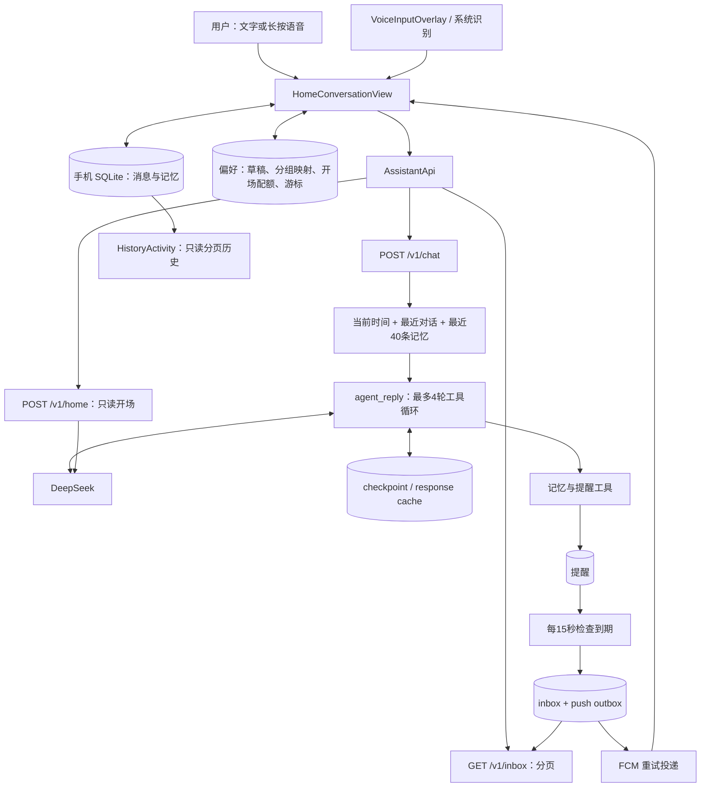
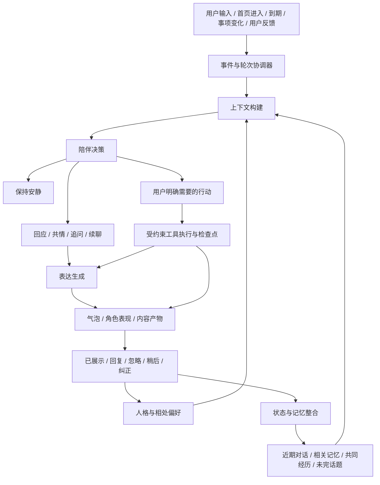

# Greta 陪伴 Agent：对话 Harness 架构与缺口

> 后续实现更新：重要话题的后台提取、App控制与一次授权跟进已进入代码，见 [重要话题实现](greta-important-topics.md)。下文“当前架构／缺口”描述的是本次实现前的评审基线，不能据此认定新增能力仍全部缺失。

日期：2026-10-16。代码基线：`b6d1daf`，应用版本 `1.6.0`（versionCode 22）。

本文基于当前仓库逐项检查，区分**已有实现、发现的问题、建议架构**。这是后续陪伴能力的设计与实施入口，不表示所有建议已经落地。历史 UI 设计见 [首页设计](greta-harness-design.md)，上次暂停记录见 [历史接续说明](greta-harness-handoff.md)。

## 1. 产品定位

Greta 的核心体验是：她能接住你正在说的话，记得你们经历过什么，在你愿意的时候接着聊，也能帮你记住事情。

优先保证五件事：

1. **此刻听懂**：分清用户想被听见、想讨论，还是希望采取行动。
2. **相处连贯**：语言和表达稳定，跨天还能接上重要话题。
3. **记忆可信**：知道记忆来自哪里，改正和忘记都有效。
4. **主动有分寸**：有具体理由才开口，用户的拒绝会改变后续行为。
5. **承诺可靠**：说过要提醒就能找到状态，没做到能解释和恢复。

首页保持宠物原大小、原位置；双方各一个最新连续发言气泡，完整记录另存。首页是会话的展示投影，不是模型上下文的全部。工具结果独立展示；模型的内部推理不进入气泡或工具卡。

## 2. 当前实际架构

此图中的“最近对话”有明确上限：主聊天客户端读取最近 28 条消息再过滤 user/assistant，首页开场读取最近 12 条再过滤；服务端记忆按更新时间取 40 条。当前没有长期话题摘要、相关性检索或独立的陪伴决策层。

### 2.1 已有模块和边界

| 现有位置 | 已有职责 | 当前限制 |
| --- | --- | --- |
| [MainActivity](../app/src/main/java/dev/pixel/sync/MainActivity.java) | 首页场景、菜单、历史入口、系统 insets | UI 生命周期驱动整个会话 |
| [HomeConversationView](../app/src/main/java/dev/pixel/sync/HomeConversationView.java) | 气泡、分组、发送、重试、开场、inbox、结果 | 展示和业务集中；难单独测试轮次与打断 |
| [VoiceInputOverlay](../app/src/main/java/dev/pixel/sync/VoiceInputOverlay.java) | 黑色录音层、手势、部分及最终转写 | 依赖设备服务；提前结束会转草稿 |
| [AssistantStore](../app/src/main/java/dev/pixel/sync/AssistantStore.java) | 手机消息／记忆持久化、分页、外部 ID 去重 | 业务状态分散在 SQLite 和偏好；本地记忆写入无版本比较 |
| [AssistantApi](../app/src/main/java/dev/pixel/sync/AssistantApi.java) | HTTP、冻结重试请求、结果解析 | 非流式；工具结构被压成摘要字符串 |
| [MemoryActivity](../app/src/main/java/dev/pixel/sync/MemoryActivity.java) | 查看、修正、删除记忆 | 同步失败被忽略，无持久重试 |
| [HistoryActivity](../app/src/main/java/dev/pixel/sync/HistoryActivity.java) | 原始消息与工具记录、每页50条 | 没有搜索、话题定位、引用继续聊 |
| [server/app/main.py](../server/app/main.py) | 上下文、模型循环、工具、提醒、开场、投递 | 多职责同文件；人格仅简短 system prompt |

### 2.2 已打通的三条路径

**用户发言**：本地入库 → 约800ms补充缓冲 → 稳定请求 ID → 模型／工具 → 保存回复与结果 → 更新各自气泡。生成期间的新补充排队，过时回复留在历史、不覆盖当前气泡；已执行动作不会因新补充而自动撤回。

**主动开场**：首页恢复 → 本地检查静默时段、次数、冷却、交互状态 → `/v1/home` 根据对话和记忆返回一句话或静默 → 再检查当前是否适合 → 入库展示。当前主要是“进入首页时的上下文续聊”，没有独立后台陪伴跟进调度。

**明确提醒**：工具写提醒 → 到期事务写入 inbox、push outbox 并更新提醒状态 → FCM 重试 + App前台30秒同步 → 去重入本地 → 首页与结果区展示。

现有工具只有 `save_memory`、`create_reminder`、`list_reminders`、`manage_reminder`。打印、同步虽有独立功能页面与接口，目前没有注册成对话模型工具。

## 3. 本次检查结论

基础交互和任务可靠性已经有可用骨架；作为长期陪伴 agent，目前最薄弱的是**关系语境、跨天记忆、主动行为反馈**。单纯把 system prompt 改得更亲切，不能补齐这些状态和机制。

本次重新运行 `tests/test_assistant_harness.py`，**11 项全部通过**。测试覆盖服务端去重、checkpoint恢复、事务回滚、提醒操作、inbox分页等；没有覆盖真实陪伴质量、Android轮次控制、语音和FCM端到端。本次未重新构建APK、未启动模拟器、未验证真实模型或真机，不能仅据用户已续接完成就推断上述流程全部验收。

仓库原接续文档仍写着“暂停、未提交”，与当前已有提交和 v1.6.0 的状态不符。应把它视为历史记录，后续以当前代码和本文为准。

## 4. 已发现的具体问题（与新增能力分开）

以下条目是代码检查结论，除现有11项测试外，未声称做过对应故障注入或真机复现。

### P0：记忆修改／删除没有可靠同步

证据：`MemoryActivity.sync()` 只发一次请求，异常直接忽略；`AssistantApi.syncMemory()` 未配对时直接返回。没有 dirty 状态、同步 outbox 或恢复后扫描。

影响：离线“忘掉这件事”只在手机生效，服务端仍可能把旧记忆放进提示词；配对前手工添加的记忆也未必会投影到服务端。界面“服务恢复后会同步”的承诺超出当前实现。

修复：本地记忆更新、tombstone 和 sync job 同事务写入，成功回执才清 dirty；配对和恢复时对账；删除优先同步。测试必须包含“离线删除→重启→联网→服务端不再召回”。

### P0：迟到的记忆结果可能覆盖用户修正

证据：`AssistantStore.upsertMemory()` 无条件 `CONFLICT_REPLACE`；聊天返回的 `memory_changes` 直接调用它。

影响：一次请求已在服务端完成但客户端超时，用户在手机修正／删除记忆后重试，缓存里的旧 revision 可能覆盖手机的新 revision，甚至恢复 tombstone。

修复：同 ID 采用版本比较与明确冲突规则，用户修正／删除优先；不得让低版本回写覆盖高版本。还需统一“手机为主库”和“服务端模型先创建记忆”的复制协议。

### P1：超时与运行状态不匹配

证据：App读超时65秒；服务端每次模型调用超时60秒，工具循环最多4轮，且有全局 `chat_lock` 等待。

影响：正常多步任务可能超出客户端等待时间；用户看到“未确认发送”，服务端其实仍在运行。checkpoint降低重复副作用风险，但没有让客户端知道任务当前阶段。

修复：引入独立 run_id 与持久运行状态；连接断开后可查询／恢复，流式事件包含开始、工具状态、最终结果。明确取消哪些尚未提交的动作，不把断开连接当成撤销。

### P1：连续补充尚不能抢在旧工具前修正意图

证据：客户端补充排到当前请求结束后才再次调用服务端；generation主要阻止旧气泡展示。

影响：“明天三点提醒我”后补“等等，改四点”，旧三点提醒仍可能先被创建。后续模型可以修改，但窗口内仍存在两个阶段，不是原子地理解成最终意图。

修复：把 utterance_group、turn revision、run 分开；工具提交前检查轮次是否过时。已完成动作如实呈现，再执行用户明确要求的补偿／修改。

### P1：提醒回应缺少明确关联

证据：入站提醒保留 external_id，但聊天请求只发 role/content，没有 reply_to_message_id、reminder_id、当前选中结果等。

影响：多条提醒后用户说“晚点”“这个完成了”，模型只能从近期文本猜目标。

修复：发言可携带当前提醒／气泡引用；目标不唯一时问一句。消息展示、读过、稍后、完成是不同状态；当前 `inbox_message.read_at` 还没有回执闭环。

### P1：工具幂等还没有覆盖全部动作

证据：创建提醒使用 operation_id，但 `manage_reminder` 没有操作结果账本；客户端“延后15分钟”接口也没有 action_id。checkpoint与副作用并非同一事务。创建提醒先校验时间，再查已有 operation_id。

影响：崩溃重放、重复点击可能重复更新／取消；某次已创建操作在时间过去后重放，还可能被报告为“过去时间无效”。单进程全局锁不能协调多个服务进程。

修复：tool_execution记录参数摘要、状态、结果；对本地SQLite副作用与操作账本尽量同事务提交。界面动作同样带幂等 ID。已完成 operation 应先读回结果，再校验一个新操作是否有效。

### P2：语音草稿和交互验收仍需补齐

证据：语音编辑／中断结果使用 `input.setText(text)`，没有与原草稿合并策略；持久草稿非空时仍可能先显示静止输入条。系统识别早停直接结束录音进入编辑。

建议：进入语音前保存草稿快照，明确追加或替换；取消恢复原草稿。测试识别器提前结束、后台中断、连续长按和边缘手势。当前语音不是可保证连续转写的独立ASR链路。

## 5. 推荐的陪伴 Harness 架构（目标，尚未全部实现）

### 5.1 事件与轮次协调器

统一处理 `user_message`、`home_entered`、`reminder_due`、`thread_followup_due`、`user_feedback`、`tool_completed`，而不是让每个界面自行拼逻辑。

三个 ID 明确分工：

- message_id：每次原始发送，不因气泡合并改变。
- utterance_group_id：连续表达的展示组，双方独立替换。
- run_id + turn_revision：处理某一版输入的运行实例，可恢复、可判断过时。

建议状态：`collecting → planning → responding / executing → completed`，另有 `superseded / cancelled / failed`。新补充可让尚未执行的旧计划过时；已提交工具具有单独状态，不能随气泡一起丢弃。

### 5.2 上下文构建

每次调用组合：

1. 当前时间、时区、设备／前台状态。
2. 稳定人格与用户选择的相处方式。
3. 当前连续表达及最近轮次，保留否定、纠正与引用。
4. 当前话题摘要和未完成的话头。
5. 相关长期记忆和共同经历，附来源与时间。
6. 当前选中的提醒／工具结果、执行状态。
7. 最近主动开口及用户反馈，避免重复问同一件事。

采用 token 预算和相关性选择；明确事实、用户修正、当前事项优先于陈旧摘要。完整历史≠每次全塞给模型；只有最近28条也不足以支撑长期关系。

### 5.3 陪伴决策

输出可验证的行为枚举：`listen`、`reflect`、`ask`、`chat`、`follow_up`、`act`、`stay_quiet`。这是对外行为决定，不要求存储或展示模型私有推理。

例：

| 用户表达 | 合适行为 | 不应默认发生 |
| --- | --- | --- |
| “今天好累” | 先接住当下，简短回应；需要时问愿不愿意说 | 自动列效率计划、建任务或长期记录负面标签 |
| “我就想说说” | 倾听，少建议 | 一直追问、强行推进事情 |
| “明天面试，有点紧张” | 陪聊；按用户意愿记录一个有时间范围的话题 | 擅自创建后台提醒或断言用户焦虑 |
| “明天九点提醒我” | 执行明确提醒，确认实际结果 | 只口头答应 |
| “让我静一静” | 简短确认并暂停普通主动开场 | 过一会儿又催问是否好些 |
| “不是三点，是四点” | 修正当前目标／计划 | 额外再建一个独立三点提醒 |

短期感受可作为当前会话的临时语境，不能自动成为长期人格结论。用户明确偏好优先于模型猜测。

### 5.4 人格与相处偏好

统一维护 PersonaPolicy，供聊天、主动开场、工具解释和直连降级共享：称呼、语言、幽默程度、回复长度、提问密度、建议偏好、声音开关、主动程度。

Greta 可以有稳定语气和表达习惯，但不需要“亲密值／好感度”来解释一切。不以用户离开或未回复为由施压，不声称自己知道用户未授权的活动。主动说明能力限制，表达关心时避免编造经历或感受。

角色表现接收结构化的轻量 cues，例如 `listening / thinking / pleased / gentle / waiting`，由UI映射动作；不让任意模型文本直接控制动画或系统行为。目前仅统一 `scene.react()`，还没有这层语义。

### 5.5 四层记忆

| 层 | 记录什么 | 生命周期与控制 |
| --- | --- | --- |
| 当前会话 | 此刻话题、用户纠正、临时情绪语境 | 会话结束或短期到期，不自动永久化 |
| 未完话题 | 想继续讨论的事、约定的跟进窗口、是否愿被问起 | open / paused / resolved / expired |
| 稳定事实与偏好 | 明确的称呼、长期喜好、事实 | 可查来源、修正、删除和同步 |
| 共同经历 | 用户希望保留的重要交流与事件摘要 | 关联原文、时间及用户允许的召回范围 |

至少支持：去重、冲突处理、新事实替代旧事实、有效时间、相关性召回、来源、删除回执。模型 confidence 只是模型自报值，不是校准后的正确概率。

“记住”和“跟进”分别建模：记得面试这件事，不自动等于获准每天询问结果。明确定时提醒才进入 reminder scheduler。

### 5.6 主动行为闭环

候选来源 → 规则门控 → 内容选择／静默 → 展示 → 用户反馈 → 调整后续行为。

候选至少附：topic_id、source_message_id、为何现在合适、最早／最晚时间、优先级、去重键、过期时间。服务端持有候选与投递状态，手机提供实时“能不能打扰”的判断；两端职责清楚。

- 有关心依据：用户愿意被跟进的具体话题、明确承诺、重要事项。
- 有停止规则：已完成、拒绝继续、用户说想安静、窗口过期。
- 有渠道区分：首页闲聊默认不发系统通知；后台跟进需用户允许。
- 有反馈：回应／稍后／别再问／忽略。单次忽略不能被解释成某种情绪。
- 有跨设备配额：每日上限和冷却不能仅存手机偏好后各台设备分别触发。

当前 `/v1/home` 可继续复用为表达生成器；主动调度与候选选择应独立出来。无需先增加大量工具或复杂多agent系统。

### 5.7 工具与内容产物

沿用现有 checkpoint、inbox和outbox，补结构化 `tool_run` 与 `artifact`：名称、输入摘要、执行状态、最终结果、关联消息／话题、可用操作、展示类型。

对话回复、工具结果、提醒行动不是同一个字符串。App目前将 tool_results压成文字，会丢掉可定位／可操作字段；应保留JSON结构，再渲染提醒卡、列表、链接等。历史也需要关联真实结果，而非仅存“创建成功”一句话。

流式事件可定义为 `run_started`、`assistant_delta`、`tool_started`、`tool_finished`、`artifact_ready`、`run_completed`、`run_failed`。断线用 last_event_id继续或查询run；文本流与工具幂等分别保证。

## 6. 建议的数据边界

### 手机

完整原始历史、草稿、当前展示状态、用户可编辑记忆主副本、待同步操作；同步确认和消息状态应尽量在同一个本地数据库中完成。

### 私有服务

运行恢复、工具账本、提醒、投递队列，以及服务端陪伴／提醒所需的记忆与话题投影。未来如需要后台跨天跟进，应显式定义哪些话题摘要同步，而不是默认复制完整历史。

当前服务端 checkpoint保存含原始请求上下文的messages，response cache长期保存回复／记忆变更，尚无清理策略。不能笼统宣称“服务端完全不存聊天”。需要定义运行缓存、摘要和删除请求的保留范围，清理检查点、缓存和关联摘要中的被遗忘内容。

建议新增数据对象（增量实现）：

| 对象 | 关键字段 |
| --- | --- |
| conversation / thread | id、summary、state、source_message_ids、updated_at |
| utterance_group | role、message_ids、revision、closed_at |
| agent_run | id、turn_revision、status、last_event_id、request_digest |
| memory | id、kind、source_ids、revision、valid_from/to、supersedes、deleted |
| followup | thread_id、consent、window_start/end、state、dedupe_key |
| interaction_feedback | candidate_id、displayed/read/dismissed/responded、timestamp |
| tool_execution | operation_id、arguments_digest、status、result、committed_at |
| artifact | run_id、type、payload、actions、state |
| sync_operation | entity_id、revision、operation、retry_at、acked_at |

## 7. 模块拆分建议

先保留原生Java、FastAPI、SQLite与现有模型；通过明确边界逐步重构。

Android：

- HomeConversationView：只负责显示与输入事件。
- ConversationController：轮次、补充、过时结果和恢复。
- ConversationRepository / MemorySyncRepository：消息、草稿、记忆和同步事务。
- ProactiveCoordinator：手机交互门控与展示反馈。
- SpeechInputSession / VoiceInputOverlay：识别适配与手势分离。
- ArtifactPresenter：结构化结果展示。

服务端：

- context_builder：预算、摘要、相关记忆和引用。
- companion_policy / persona：倾听、回应、提问、行动、静默及表达约束。
- agent_runner：运行状态、checkpoint和事件。
- memory_service：候选、合并、版本、投影、忘记。
- followup_service：未完话题、许可和候选。
- tool_executor：校验、动作账本和结果。
- delivery_service：提醒、inbox和push outbox。
- observability：trace、延迟、错误与行为决定码；不默认记录完整敏感原文。

先拆可测的业务，再整理UI；避免仅把同一个长文件机械切成多个文件。

## 8. 实施优先级

### 第一阶段：让“记得／忘掉／答应”可信

优先修复第4节P0项，补记忆同步outbox、版本冲突与tombstone；补工具动作幂等、运行状态查询和超时协调。明确单用户／多设备的作用域。没有这些，新增陪伴记忆会放大不一致。

### 第二阶段：形成陪伴连续性

统一人格与相处偏好；加入当前话题摘要、未完话题、相关记忆召回和用户明确纠正；建立倾听／回应／建议／行动的模式选择。

验收：十天前的重要话题能按需找到；用户只是倾诉时不强行列计划；纠正后不再重复旧事实。

### 第三阶段：让主动关心有依据

候选、窗口、许可、展示回执、拒绝／稍后反馈闭环；跨设备配额。保留静默选项，先做少量高质量跟进。

验收：“面试后可以问问我”在合适窗口出现一次；“别再问了”会终止该话题主动跟进；未回复不会反复追问。

### 第四阶段：表达与内容体验

稳定的流式回复、工具事件和结构化内容、情境角色动作、语音服务适配；历史搜索与引用继续聊。语音朗读作为用户可选能力，不改变默认文字陪伴。

## 9. 陪伴场景评测

现有11项测试继续保留，新增三类验证：

1. 状态回放：纯业务测试，不依赖真实模型，覆盖补充／否定、离线删除、版本冲突、断线恢复、读过与完成分离。
2. 固定对话集：回放多轮与跨天情境，检查事实来源、话题延续、是否打扰、人格一致性和工具选择，不能只看单轮回复是否“温柔”。
3. 真机端到端：长按滑动、识别早停、草稿、键盘、后台、通知、输入时晚到开场。

必测例：

- “陪我聊聊，不要建议”→后续数轮确实少建议。
- “我只是不想出门”→不会永久保存“用户社交恐惧”。
- “记住我不喝咖啡”→跨多天可召回；“现在可以喝了”→旧事实被替代。
- 离线“忘掉这件事”→恢复后两端均不召回，缓存与摘要也遵守删除范围。
- 说到一半补“不是今天，是明天”→工具提交使用最终明确意图。
- 多条提醒后“这个晚点”→目标不清楚时追问，不猜错。
- 开场生成期间用户开始输入→晚到内容不覆盖或插话。
- 用户反复没回应某话题→减少该话题的主动尝试，不制造情绪叙事。
- 模型暂不可用→已保存提醒仍能按时形成inbox，状态可恢复。

指标以用户感受与可靠性为主：纠正被尊重、错误记忆率、重复追问率、无依据开场率、承诺兑现、忘记生效、恢复成功和延迟。不要把聊天时长或用户依赖程度当作单一成功指标。

## 10. 下一轮建议范围

建议先完成一个清晰闭环：**用户说过的一个重要话题 → 她正确记住 → 用户允许跟进 → 合适时机开口一次 → 用户回应／拒绝 → 状态收敛。**

同时补齐记忆同步与删除可靠性。这个闭环最能体现陪伴agent的价值，也能复用当前首页、模型、提醒和投递基础。
