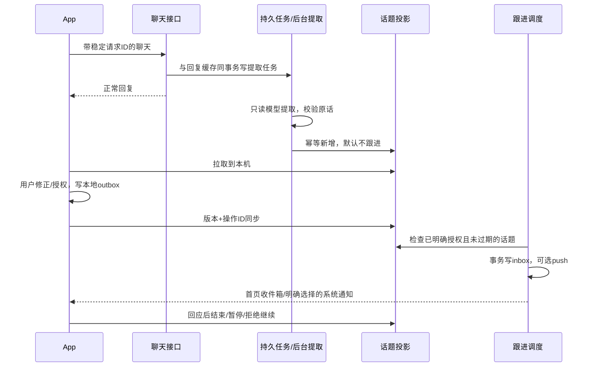

# 重要话题：当前实现与使用

日期：2026-10-17。状态：代码已实现，服务端隔离测试与开发版构建通过；尚未部署私有服务或进行真实模型、FCM端到端验收。

## 用户体验

正常聊天先回复，随后由私有服务异步整理重要话题，不依赖手机常驻后台。首页菜单 → **重要话题**：查看话题、原话、记录时间和当前状态。

自动提取只产生有时效的具体事件／项目／希望重访的话题，不授权跟进，也不转换为长期人格标签。默认30天过期；明确事件可在事件后7天过期（最长初始30天）。原话必须是本轮用户实际说过的连续片段，不能取自Greta回复。是否“重要”仍由模型判断，规则和测试不保证真实模型永远判断正确。

可执行：

- 修正话题名称，原话保留为来源。
- 选择未来时间，允许关心一次；默认仅首页，系统通知需要单独选择。
- 不再主动追问、先放一放、这件事聊完了。
- 忘记：移除话题标题／原话并停止后续跟进；原聊天历史不在这个操作中删除。

操作先保存本机并进入SQLite同步队列，网络恢复后重试。**待同步状态不代表服务端已经改变或承诺了时间**；离线撤销无法阻止服务端在尚未收到撤销前投递。版本冲突保留本机修改，页面允许选择本机或服务端版本，不能静默覆盖。

对话中也可明确请求停止／结束／忘记或安排已识别话题的跟进；模型通过 list_topics、manage_topic 执行。含糊目标或时间需要追问，不能猜“这个”指哪件事。首次话题提取是异步的，刚回复完时可能还未整理好；可稍后在话题页刷新。

## 实现数据流

### 服务端

新增 `server/app/topics.py`，主服务负责注册路由、启动worker及调用调度。

- `topic_job`：本轮连续用户发言、时区、说话时间；聊天回复和任务写入同一事务。相同请求只建一个任务；明确日期的不同事件分开去重。
- worker：每3秒取任务，3分钟执行租约，重启可恢复；最多3次提取尝试，间隔退避；最终失败或成功后清除任务原文。失败写类型日志，不将原话写入日志。
- `topic`：标题、来源、事件时间、到期、状态、授权、关心时间、通知选择、版本。
- `topic_operation`：稳定操作ID、参数摘要和返回结果，支持幂等重试。
- 到期跟进与inbox、push outbox、话题状态同事务写入；一次授权只形成一条跟进。发送文案用事实模板，不额外调用模型，不推测结果。
- 暂停／结束／拒绝／忘记会撤销旧inbox候选和待发push。已经展示的消息属于历史，不能当作从未发生。
- 忘记保留去重哈希与tombstone；同一日期事件的相同标题或相同证据片段不能被旧提取结果重新创建。它不保证语义完全不同的改写被永久屏蔽，后续还需完善语义去重／用户重新授权机制。
- 普通首页开场不加载话题投影，并明确禁止擅自追问个人事件结果。当前仍依赖模型遵守该约束；话题的正式调度则由代码检查授权。

接口：

| 接口 | 用途 |
| --- | --- |
| GET /v1/topics | 包含版本和tombstone的同步投影 |
| POST /v1/topics/{id} | base_revision + operation_id，更新名称、状态或明确跟进授权 |
| list_topics / manage_topic | 对话内明确操作工具 |

所有接口沿用已配对设备认证，服务仍按**一个人、多台设备**设计，不是多租户平台。

### App

- SQLite升级到v3，增加 `topic`、`topic_outbox`，保留原有消息与记忆。
- `TopicRepository`：原子本地修改、按序同步、版本保护和冲突处理；拉取不能覆盖dirty本地记录。
- `TopicsActivity`：原话、状态、名称修正、日期／时间选择、跟进渠道和忘记等操作。
- 首页前台同步每30秒顺带同步话题；话题页进入和操作后同步。**不承诺App完全关闭时立即上传离线修改**；再次前台或打开话题页后继续。
- 本地暂停／结束／忘记的话题ID随新聊天请求传入，服务端构建话题上下文时排除，即使对应修改尚未同步，也不主动注入旧话题投影。这不是从原始聊天历史或已有缓存中抹掉相同文字。
- 未配对／直连模型模式不具备服务端后台提取，页面明确提示连接助理服务。

## 验证

- 原11项harness测试 + 新21项话题测试，共32项通过。
- 覆盖：回复不等待提取、幂等入队、连续原话证据、无依据结果拒绝、寒暄可不产生话题、模型不能授予跟进权限、提取去重且不覆盖修正、一次关心、系统通知显式选择、撤销投递、忘记防旧结果恢复、版本冲突、操作重试、时间校验、过期、认证、context屏蔽、对话结束工具、worker租约恢复与事务回滚。
- Android开发版构建与Lint通过。
- 模拟器验证了旧数据库v2升级、正常首页菜单入口、空状态、虚拟话题的原话／时间／状态卡片和管理菜单。
- 用虚拟话题实际操作“不再主动追问”，停止进程后读取SQLite确认状态revision与outbox仍保留；随后恢复原测试数据并停止模拟器。
- 真实模型判断质量、中文真机使用、FCM通知到达未验证；尚未部署，启用需要App和私有服务同时更新。

## 后续边界

这一版形成“识别—查看—明确授权—一次跟进—结束／拒绝”的基础闭环。它不包含自动判定用户愿意被跟进、无限期后台主动关心、完整语义记忆检索、自动从所有历史回填话题或修复旧长期记忆模块的全部同步问题。
